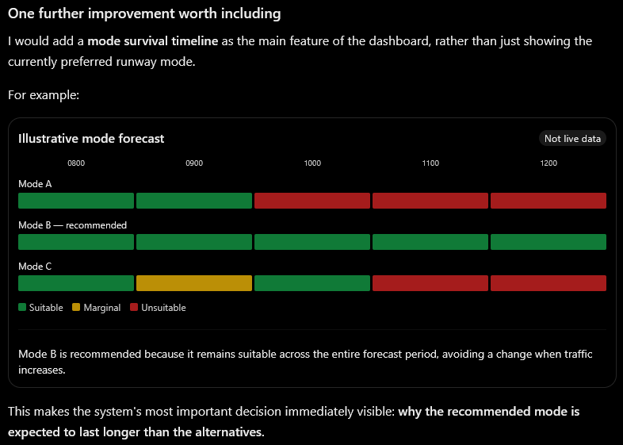

# Runway Mode Planner (first airport: Sydney, YSSY): requirements

Status: recorded 22-10-2026 from the owner's initial brief and answers in chat; amended 23-10-2026 (per-mode crosswind limit, airport-agnostic design). This is the source of truth for what the app must do. The design that meets it is in [DESIGN.md](DESIGN.md).
Language: British English. Dates DD-MM-YYYY, times UTC.

## 1. Purpose
A web application that recommends the runway operating mode for Sydney Kingsford Smith Airport (YSSY). It is a decision-support aid for VATSIM controllers, not for real-world operations. It uses live METAR, TAF, live VATSIM traffic, the airport's standard modes, the airport's operating plan (rules for runway preference, noise sharing and time of day), dry or wet runway state, and forecast survivability with changeover planning.

**Central goal:** anticipate weather and traffic changes, pick a mode likely to survive the forecast, and minimise disruptive mode changes, especially during high VATSIM traffic. The objective is not the best mode for the current METAR alone.

## 2. Owner decisions (chat, 22-10-2026)
| ID | Decision |
|---|---|
| OD-1 | Phase 1 users: the owner only, running the app locally in a browser. Later phases: a few controllers, then public on the VATPAC website. |
| OD-2 | Future phase: the app must be compatible with the other tools at https://vatpac.org/tools and deployable there. Publication is not part of phase 1. |
| OD-3 | Architecture: browser only, but built so a small server can be added later. |
| OD-5 | Reference rules: every rule in every airport pack is marked verified or provisional, with its source. Where no current official source has been read, the rule ships provisional. Where two sources for the same rule differ, the owner decides and the decision is recorded in the pack. |
| OD-6 | All variables and constants live in reference-data files, not in code: for example mode priorities, the forecast window, and the definitions of light, medium and busy traffic for arrivals and departures. |
| OD-7 | Documents first: a design and architecture document and a requirements document are written before any code. |
| OD-8 | 23-10-2026: the maximum crosswind allowed is 20 kt for every mode. The limit is held per mode in reference data, so a mode can later be given a different value. |
| OD-10 | 23-10-2026: every mode listed in a pack is treated as verified and approved for use by the owner. The engine does not gate recommendations on a rule's provisional or verified status; the status is shown for information. This resolves the conflict in the earlier RD-4 wording. |
| OD-11 | 23-10-2026: wind direction and runway heading are taken as the same reference. A 155 degree wind on a 155 degree runway is a pure headwind. There is no true or magnetic conversion and no magnetic variation in the data. |
| OD-12 | 23-10-2026: light and variable wind is handled with a calm threshold and a comparison tolerance, both pack values (WC-11). |
| OD-13 | 23-10-2026: when no mode is suitable the screen never names a least-bad mode. It shows the blocking cause per mode and what change would restore a mode (OP-11). |
| OD-14 | 23-10-2026, partly superseded by OD-21: the app has no manual input for the runway condition. Runway wetness comes only from the METAR and TAF. The only controller input is the optional current mode (OD-21). The app only advises. |
| OD-15 | 23-10-2026, superseded by OD-20: BECMG is treated as an ordinary change at its start time (WX-8). |
| OD-16 | 23-10-2026: a mode's capacity, set per mode in reference data, is a hard limit (TR-6). |
| OD-17 | 23-10-2026, refined by OD-25: the METAR decides the first forecast slots for a pack-set time and the TAF only warns inside that time (WX-7); forecast slots with no data (UNKNOWN) may be planned through, marked uncertain (OP-13). |
| OD-18 | 23-10-2026: the optimiser scores the operating-plan preference with an explicit penalty per ranked row in the pack; traffic is estimated as far ahead as the data supports with no assumed level beyond it; there is no look-ahead past the forecast window. |
| OD-19 | 23-10-2026: simplifications for the first build. One operating plan applies every day of the week (no weekday, weekend or holiday variants); time-of-day bands remain. Aircraft-class runway qualifiers are ignored by the wind checks. No per-mode visibility or ceiling limits. No runway closures. Departures: every aircraft on the ground at the airport counts as departing in the next slot. Arrivals: airborne aircraft are timed from distance and groundspeed, not-yet-departed flights as set out in OD-22, and aircraft with no flight plan are ignored. |
| OD-20 | 23-10-2026: simplification pass. Removed: the short-stay (minimum mode duration) penalty, the unknown-slot penalty, the continuity penalty and with it the app's memory of its previous recommendation, the early-change minimum benefit, the BECMG transition-window rule, per-mode tailwind overrides, the mode tie-break field, noise-class labels and notes, the recommendation history panel (G) and the mode comparison panel (E). Accepted risk: with no continuity penalty the recommendation may flip between recalculations on small weather changes. |
| OD-21 | 23-10-2026: the operator may enter the current mode from a pull-down menu (the list of enabled modes, plus Not set). This partly reverses OD-14. It is the only controller input. The runway condition is still derived only from METAR and TAF, with no manual control. The current mode is optional; if it is not set the plan has no starting mode. |
| OD-22 | 23-10-2026: aircraft on the ground at another airport with a flight plan to the pack's airport count as future arrivals. They are assumed to take off spread evenly across the next 30 minutes (pack value), and to arrive after distance divided by an assumed ground speed (pack value). Filed times are not used. All such aircraft are counted; the demand horizon decides which fall inside the window. |
| OD-23 | 23-10-2026: the audit trail records setting and current-mode changes only, as a local, exportable, not tamper-proof record. Security protections adopted: the notice cannot be overridden by a pack; text-only rendering; input size and range limits; hosting headers and a dependency policy (section 18). Pack file changes follow the document process (not reviewed separately). Data-staleness limits and poll intervals are pack values (UP-5). Sydney mode capacities stay empty until the owner supplies figures (SY-7). |
| OD-24 | 23-10-2026: slots are clock-aligned half-hours with no extra TAF-change slots, and slot 1 contains now (OP-2). A tailwind or crosswind above zero and within 3 kt of its limit is MARGINAL (WC-13). The capacity check uses what is known: known arrivals plus known departures, with missing departures treated as zero, so a known count above capacity makes the mode UNSUITABLE (TR-6). The Sydney pack ships a provisional draft: the 2015 table has no preference order, so every mode has equal preference by day; the Curfew mode is preferred at night (SY-8). |
| OD-25 | 23-10-2026: inside the METAR window the METAR decides each cell's status and the runway state, and a TAF that would make a mode worse makes the cell MARGINAL (WX-7). EARLY MODE CHANGE RECOMMENDED is shown only to avoid a worse forced change (OP-7). There is no confidence level; Panel A shows an uncertainty line instead (DB-2). |
| OD-26 | 23-10-2026: the forecast window and the timeline show the full TAF validity by default; 2, 4 and 6 hours were options. Superseded in part by OD-31 (the 2-hour option is dropped). |
| OD-27 | 23-10-2026: variable wind above the calm threshold makes every mode MARGINAL (cause VRB) unless the full speed breaks a limit on every runway the mode uses (WC-11). Superseded in part by OD-33 (the wet tailwind limit does not apply to variable wind; UNSUITABLE only when the dry tailwind limit or the crosswind limit is broken on every runway). On screen the user can change only the current mode and the forecast window; every other setting is edited in the pack files and reloaded, and on-screen configuration comes in a later iteration (DB-9). |
| OD-28 | 23-10-2026: in phase 1 the user enters the METAR and the TAF by hand, pasting each into a text box. Automatic fetching of weather is a later phase, so no weather provider, proxy or browser-access test is needed now. VATSIM traffic is still fetched automatically. The weather source stays an interface so a fetching version can replace the paste box later (WX-1, WX-3). Amended by OD-37 (24-10-2026): phase 1 now fetches weather automatically as well, with paste kept as an override. |
| OD-29 | 23-10-2026: the pasted METAR and TAF are decoded with the metar-taf-parser library (MIT, no dependencies), pinned to an exact version and used only behind a thin adapter of our own, so it can be replaced or copied into the repository and patched. This is the owner's approval of one more runtime dependency (WX-1, WX-3). |
| OD-30 | 23-10-2026: pasted METAR and TAF are not stored; every visit starts with empty boxes and "No weather entered" (WX-1). The current mode is stored in the browser until changed, and is flagged amber when set more than `currentModeStaleMinutes` ago (default 120, pack value). A METAR older than its window is accepted and flagged stale, not refused. If only one report is entered the app works with it and a banner names the missing one (WX-9). |
| OD-31 | 23-10-2026 (owner, chat): the window choices on screen are 4 hours, 6 hours and the full TAF validity, with the full TAF as the default. The 2-hour option is dropped. Amends OD-26, OP-2 and DB-3. |
| OD-32 | 23-10-2026 (owner, chat): the traffic panel (D) shows no trend. The raw METAR and TAF are shown at the top of the screen, in the weather entry boxes. Panel C shows runway components against the limits only, with no raw or decoded text. Amends TR-3 and DB-8. |
| OD-33 | 23-10-2026 (owner, chat): variable wind (VRB) is not judged against the wet-runway tailwind limit. VRB above the calm threshold makes a mode MARGINAL with the cause VRB. It is UNSUITABLE only if the full speed breaks the dry tailwind limit or the mode's crosswind limit on every runway the mode uses. Amends OD-27, WC-1 and WC-11. |
| OD-34 | 23-10-2026 (owner, chat): weather in the vicinity (code VC) never counts as precipitation or as a wet runway. Amends WC-9. |
| OD-35 | 24-10-2026 (owner, chat): every wind component, limit and other figure shown on screen or in a cell's reason text is a whole number of knots, rounded for display only. The underlying calculation, the tolerance comparison and the near-limit margin all keep full precision; nothing is rounded before a limit is applied. Amends WC-3. |
| OD-36 | 24-10-2026 (owner, chat): the screen shows UTC only; the airport's local time is no longer shown anywhere, because it complicated the screen and daylight saving was a source of mistakes. Superseded: Q7 and WX-5. Unaffected, because they are not a parallel clock display: the audit trail's own "local record, not tamper-proof" label (RD-6), and an operating-plan band's own hours, which are still defined and evaluated in the airport's local time (AG-5, DESIGN section 4c) and so are still described that way in the settings drawer. |
| OD-37 | 24-10-2026 (owner, chat; issue 16 on the repository): two coupled changes. (1) An always-visible ICAO entry box in the header replaces the airport selector that only appeared when more than one pack was listed. Typing an ICAO only switches between airports that already have a reviewed data pack listed in `refdata/app.json`; it never creates, fetches or guesses runway, mode or operating-plan data for another airport (OD-5, RD-2). An ICAO with no pack shows "No data pack for <ICAO> yet. Available: <listed ids>." and changes nothing. (2) The METAR and the TAF are fetched automatically for the pack's weather station and polled every `weatherPollMinutes`; the paste boxes stay as an override. METAR comes from metar.vatsim.net; TAF from datamask.org with metars.eu as the fallback. Both TAF services are small free third-party relays with no uptime guarantee; a failure keeps the previous report and never blocks the rest of the page. Fetched text goes through the same checks as pasted text (WX-1). Amends OD-28, DB-9, WX-1, WX-3, WX-6, UP-2 and UP-5. |
| OD-38 | 24-10-2026 (owner, chat; UX review finding 1): the recommendation (Panel A) comes directly after the notice and the freshness chips, and the weather entry (the fetched reports and the paste option) moves below the timeline (B), so the answer is visible on load, including on a phone. The freshness chips and the data notices stay at the top, so a missing, stale or failed weather report is still seen first. Amends OD-32 (the raw reports are no longer at the top of the screen) and the screen order in UI_DESIGN section 3. |
| OD-9 | 23-10-2026: the app will later be used for other airports, so the code must be airport-agnostic and entirely reference-data driven. YSSY is the first dataset, not a special case. This is a key requirement and takes precedence over convenience in every design choice. |

## 3. Reference-data requirements
| ID | Requirement |
|---|---|
| RD-1 | Two independently editable datasets: A, standard runway modes (assignments, capacity characteristics, eligibility); B, operating-plan priorities (preference order and time-of-day rules). |
| RD-2 | Every rule keeps its source, document version, effective date where available, and verified or provisional status. Never fabricate official rules or capacities. |
| RD-3 | Per mode: number and description; arrival and departure runways; exact bearings; traffic capacity; operating-plan priority class; time-of-day eligibility; weather constraints (including its own maximum crosswind, OD-8); source. |
| RD-4 | Each airport pack lists the standard modes for that airport, including variations. Every mode listed in a pack is treated as verified and approved (OD-10); only enabled modes are recommended. No arbitrary runway combinations. The Sydney mode list is in section 16. |
| RD-5 | Tunable values in refdata (OD-6): mode priorities; forecast window; light, medium and busy traffic bands for arrivals and departures; tailwind limits, the wet-runway probability threshold, the drying time, and the default crosswind limit (a per-mode value overrides it); preference, marginal and change penalties; changeover preparation time; calm wind and limit tolerance; METAR validity window; demand horizon; precipitation codes; stale-data limits; poll and recalculation intervals; display time zone. |
| RD-6 | Audit trail. Each change to a setting or to the current mode is recorded with: time (UTC), airport, what changed, old value, new value. The record is kept in the browser under the airport, can be exported as a file, is shown in the settings drawer, and is labelled "local record, not tamper-proof". It has a size cap (oldest entries drop first). Changes to pack files are not recorded by the app (OD-23); the repository history is the record of those. |
| RD-7 | Self-documenting data. Every tunable value, and every mode, runway and rule record, carries a `description` field in the JSON: what it means, its unit, how the engine uses it, and its provisional or verified basis. For example `wetRunwayProbabilityPct` explains that a PROB group with rain at or above it makes a slot WET. The engine never reads `description` (or any `_`-prefixed note field), and it has no effect on any result. It exists for people editing the files; the settings screen may show it as help text. The schema allows it, and the loader strips it before the data reaches the engine. A validation rule fails the pack if a tunable value has no `description`. |

## 3a. Airport-agnostic requirements (OD-9)
| ID | Requirement |
|---|---|
| AG-1 | No airport-specific fact appears in code: no ICAO code, runway name, mode number, bearing, coordinate, time zone, curfew time, threshold, limit, source URL or wording. Code reads all of them from the active airport's reference data. |
| AG-2 | Each airport is one self-contained reference-data pack (a folder of files, one per dataset). Adding an airport means adding a pack and selecting it; no code change, no rebuild of the logic. |
| AG-3 | The pack defines: airport identity (ICAO, name, position, elevation, local time zone and daylight-saving rule); runways and their ends (heading, optional threshold positions for the diagram); runway groups (for example parallel pairs); modes; operating-plan rules; traffic classification geometry (terminal radius, approach distance, ground-versus-airborne rules); weather sources and station identifiers; wording used on screen. |
| AG-4 | Modes are generic records: a list of arrival runway ends, a list of departure runway ends, and eligibility. The engine never refers to a mode by number or name. |
| AG-5 | Time-of-day rules (curfew and shoulder periods) are expressed in a generic rule schema in the pack, evaluated in the airport's own local time zone. One operating plan applies every day (OD-19). The engine has no notion of "curfew" except as a rule it reads. |
| AG-6 | The runway diagram (panel F), the weather runway table (WX-2) and the timeline rows are all drawn from the pack's runway and mode data. Nothing is laid out for three runways by hand. |
| AG-7 | Mode count, runway count and traffic bands are not fixed. The engine, optimiser and screens work for any number of modes and runways, including a single-runway airport, and for airports whose dominant limits differ (for example a different tailwind limit). |
| AG-8 | The pack carries its own provenance (RD-2). Switching airport must never leave data from the previous airport in use (settings, the current mode and the audit trail are keyed by airport). |
| AG-9 | The app name, titles, notices and labels that mention an airport are built from the pack at run time. |
| AG-10 | A schema validates every pack on load and reports clearly what is missing or inconsistent, for example a mode that names a runway end that does not exist. An invalid pack is refused, never partly used. |
| AG-11 | Proof of agnosticism: the automated tests include a second, fictional airport pack (different runway count, names, mode set, time zone, limits) and the whole scenario suite (section 11) runs against it as well as against YSSY. A static check fails the build if an airport-specific literal (the active pack's ICAO, runway or mode names) appears in source code outside the pack and test fixtures. |
| AG-12 | Where one airport needs a rule the schema cannot express, the schema is extended generically (a new field with a default that leaves other airports unchanged), never a code branch on the airport. |
| AG-13 | Country-agnostic as well as airport-agnostic. Source names, authorities, document titles, units (knots, metres, feet, hPa or inHg), report conventions and notices are pack data. The sources and authorities named for Sydney (Airservices Australia, the Sydney Airport LTOP) belong to the Australian/Sydney pack only. Where a country's METAR or TAF format differs, the parser is extended generically, never by a branch on country. |

## 4. Wind and runway-condition requirements
| ID | Requirement |
|---|---|
| WC-1 | Tailwind limits for dry and wet runways are pack values (RD-5). A mode is unsuitable if any required runway exceeds the limit for the current runway condition. Variable wind is judged against the dry limit only (OD-33). The Sydney values (dry 5 kt, wet 0 kt) are in section 16. |
| WC-2 | Headwind = speed x cos(direction - heading); tailwind = max(0, -headwind); crosswind = abs(speed x sin(direction - heading)). For both, speed is the stronger of the mean wind and the gust. Wind direction and runway heading share one reference (OD-11): no conversion between true and magnetic. |
| WC-3 | Handle gusts and variable wind. Never round before applying limits; display as a whole number (owner decision, 24-10-2026, amending the earlier one-decimal rule; OD-35). |
| WC-4 | Runway state is DRY, WET or WET POSSIBLE and is derived only from the METAR and TAF; there is no manual selection (OD-14). The runway is not dry the moment rain stops (WC-10). |
| WC-5 | WET POSSIBLE evaluates the dry and wet cases separately and flags uncertainty. A mode that passes only the dry case is MARGINAL, never SUITABLE. Where the first slot's METAR shows no rain, the state is DRY (owner decision, 23-10-2026), and the screen states the assumption. |
| WC-6 | Crosswind limits are configurable and labelled as simulation settings unless a verified rule exists. |
| WC-7 | The maximum crosswind is a per-mode value in `modes` reference data (`maxCrosswindKt`). Initial value 20 kt for every mode (OD-8). A fallback default in settings applies only to a mode that has no value of its own. |
| WC-11 | Calm and tolerance. Two pack values (tunables with a `description`, RD-7): `calmWindKt` (default 3, provisional simulation assumption) and `limitToleranceKt` (default 0.05, provisional). Variable wind (VRB) at or below `calmWindKt` counts as calm: no tailwind and no crosswind component. Variable wind (VRB) above it makes every mode MARGINAL with the cause VRB; a mode is UNSUITABLE only if, on every runway it uses, the full speed breaks the dry tailwind limit or that mode's crosswind limit (OD-33, superseding the wet-limit wording of OD-27). A direction range (for example 160V220) is tested at the worst direction in the range. A computed component is compared with its limit as `component <= limit + limitToleranceKt`, so floating-point noise cannot fail a 0 kt limit. Every runway a mode uses is judged on its own, with no special rule for modes that use opposite directions (owner decision, 23-10-2026: a tailwind on one is a headwind on the other, so this is not treated as an issue). Such modes simply pass only in calm, light or cross winds. |
| WC-12 | First-slot runway state. Slot 1 is WET if the latest METAR reports precipitation or recent precipitation; otherwise DRY. Stored earlier METARs are not used (owner decision, 23-10-2026). |
| WC-13 | Near-limit margin. A tailwind or crosswind that is above zero and within `nearLimitMarginKt` of its limit (pack value, default 3, provisional) makes the cell MARGINAL, with the cause and the figures shown. A wind at or below the limit but outside the margin is SUITABLE. With a 0 kt limit nothing can be within the margin, so a wet runway is never amber for this reason. |
| WC-8 | A mode is unsuitable if the crosswind on any runway it uses exceeds that mode's own limit. Crosswind is taken at the stronger of mean wind and gust, with no rounding before the test, and is shown against the limit of each mode. The timeline reason names the mode's limit, not a global one. |
| WC-9 | Forecast wet runway. A future slot is WET when its prevailing weather (the TAF base group, FM, or BECMG from its start time) includes precipitation, or when a PROB group that is not on a TEMPO or INTER has precipitation and a probability at or above `wetRunwayProbabilityPct` (refdata, default 40, provisional simulation assumption). Any TEMPO or INTER precipitation, with or without a PROB, and any PROB group below the threshold, make the slot WET POSSIBLE: the mode is judged on both cases and is MARGINAL where the wet case would fail it. The precipitation codes that count are a refdata list. Vicinity weather (VC) never counts as precipitation (OD-34). |
| WC-10 | Drying time. After the last WET slot of each wet spell the runway stays WET for `dryingTimeMinutes` (refdata, default 60, provisional simulation assumption), then becomes DRY. WET POSSIBLE slots do not start the drying clock. The first slot is WET if the latest METAR reports precipitation now or recent precipitation (an RE group); otherwise DRY (WC-12). |

## 5. Weather requirements
| ID | Requirement |
|---|---|
| WX-1 | The latest METAR is fetched automatically (OD-37) and the user can paste one over it (OD-28). Decode it: observation time, wind, gusts, variable wind, visibility, weather, cloud, temperature, QNH. Show the raw and decoded text and the observation age, taken from the report's own time group and the clock. Pasted text is untrusted input: plain text only, size-capped, validated before use (SEC-3). A report that fails to decode is refused with a message naming what could not be read, and the previous report stays in use. The report's station must match the pack's weather station. |
| WX-2 | Show headwind, tailwind and crosswind for every runway end defined in the airport's runway data and mark ends over the limits. The list of runway ends comes from data, not code. |
| WX-3 | The user pastes the TAF into a text box. Decode it: FM, BECMG, TEMPO, INTER, PROB30, PROB40 (including PROB on TEMPO), wind, visibility, weather, cloud, validity. See WX-1 for the entry rules. |
| WX-4 | Produce forecast conditions for every 30-minute slot. BECMG is treated as an ordinary change at its start time (WX-8). TEMPO is not prevailing but its effect is evaluated. |
| WX-5 | UTC internally and on screen. No local time is shown (owner decision, 24-10-2026, OD-36, superseding the earlier Q7 answer). |
| WX-7 | Near-term blend of METAR and TAF. The latest METAR governs the forecast slots that start within `metarValidityMinutes` of its observation time (pack value, default 60, provisional). After that the TAF governs. Inside the METAR window the METAR decides each cell's status and the runway state; if the TAF for that slot would make the mode worse (a worse status for that mode), the cell is MARGINAL, with the TAF reason shown. A TAF issued after the METAR does not replace the METAR inside the window. If there is no METAR, or it is older than the window, the TAF governs from slot 1 and slot 1's runway state is DRY (WC-12). |
| WX-8 | BECMG is treated as an ordinary change at its start time: the weather in the BECMG group applies from the start of its window (OD-20). |
| WX-9 | One report only. METAR only: the METAR window is judged and later slots are UNKNOWN (uncertain, planned through). TAF only: the TAF governs from slot 1 and slot 1 is DRY. Neither: no weather entered, no recommendation (OP-13). A banner names the missing report. Reports are not stored between visits; the boxes start empty (OD-30). A METAR older than `metarValidityMinutes` is accepted and shown with a stale flag; it governs no slot. |
| WX-6 | Weather is fetched automatically (OD-37, amending OD-28), with paste kept as an override. The fetching uses a reliable aviation weather API rather than scraping a page (the allmetsat page named in the original brief is a reference, not the source), with robust parsing and handling of failures, stale data, caching and rate limits. The weather source is an interface so the paste box can be replaced. METAR: metar.vatsim.net. TAF: datamask.org, then metars.eu if that fails; neither is NOAA or VATSIM, so a failure keeps the previous report and says so. The stripped duplicate "TAF TAF" prefix that datamask.org passes through is removed before decoding. The credit "NOAA/NWS and Datamask Aviation" is shown in the app. Fetched text is size-capped and checked exactly like pasted text, including the station match. A report the user applied by hand pauses automatic updates for that report until the user resumes them; the plan is never changed by a failed fetch. |

## 6. Traffic requirements
| ID | Requirement |
|---|---|
| TR-1 | Retrieve live aircraft from the official VATSIM data feed; follow its guidance on update frequency and limits, and poll every 5 minutes by default (UP-2). |
| TR-2 | Arrivals: destination is the pack's airport, approaching, in the terminal area, or likely to arrive within the demand horizon (TR-7). Departures: departing the pack's airport and on the ground (gate, taxiing, awaiting departure). Airborne departures are not pending demand. No double counting. |
| TR-3 | Show connected arrivals and departures; estimated arrivals and departures per slot as far ahead as the data supports (TR-7); estimated movements per hour (no trend is shown, OD-32). Connected aircraft are not movements. |
| TR-4 | Classify demand light, medium or busy (shown as LOW, MEDIUM, HIGH) from configurable bands for arrivals and departures. Initial thresholds are provisional simulation assumptions, clearly labelled. |
| TR-6 | Capacity is a hard limit. Each mode has a maximum capacity in reference data, in total movements (arrivals plus departures) per hour; `null` means no limit is set. A mode is UNSUITABLE in a slot where known demand, scaled to the slot length, exceeds its capacity. Known demand is the known arrivals plus the known departures; departures are known only for the next slot, and missing departures count as zero, so the check uses a lower bound (owner decision, 23-10-2026). Where nothing is known the check is skipped and the cell is marked uncertain, never UNSUITABLE. The owner accepts that rough demand estimates can therefore change a recommendation (23-10-2026). |
| TR-7 | Demand horizon. Demand is estimated as far ahead as the data supports (airborne arrivals timed from distance and speed; aircraft on the ground elsewhere and bound for the airport assumed to take off spread evenly over the next 30 minutes, OD-22), up to a pack cap `demandHorizonMinutes` (default: the forecast window). Beyond that, demand is unknown, not invented. Slots with unknown demand skip the capacity check, use a flat `unknownDemandChangePenalty`, give no pre-emptive advice, and are marked uncertain (OD-18). |
| TR-5 | Check each mode's capacity against observed and forecast load. Where future traffic cannot be estimated, show uncertainty, not invented demand. |

## 7. Optimiser requirements
| ID | Requirement |
|---|---|
| OP-1 | A deterministic, auditable optimiser evaluates the whole forecast and recommends a sequence of modes. No language model is the final selector. |
| OP-2 | Forecast window: the full TAF validity by default (owner, 23-10-2026); options 4 and 6 hours (OD-31); 30-minute slots aligned to the clock (:00 and :30), with slot 1 containing now and no extra slots at forecast change times. A forecast group applies to the slot containing its start time. |
| OP-3 | Per mode: suitable now; suitable in each slot; continuous viable duration; first marginal slot; first unsuitable slot; cause; replacement mode; preferred changeover window. A mode is not continuously viable if any intervening slot breaks a mandatory constraint. |
| OP-4 | Classify each mode and slot SUITABLE, MARGINAL, UNSUITABLE or UNKNOWN, using weather, tailwind, crosswind, runway condition, capacity, operating-plan restrictions and uncertainty. |
| OP-5 | Rolling-horizon, time-dependent sequence optimisation (dynamic programming or constrained shortest path). Hard constraints for mandatory rules; weighted penalties only for soft preferences. Hard constraints are never overridden by a change penalty. |
| OP-6 | Change penalty by traffic level (light, medium, busy), configurable. During busy traffic prefer keeping a suitable mode, avoid changes only to improve operating-plan preference, prefer resilient modes before a peak, plan unavoidable changes for quieter periods. Never keep an unsuitable mode to avoid disruption. |
| OP-7 | Early change. Show "EARLY MODE CHANGE RECOMMENDED" only when the mode being left becomes UNSUITABLE later in the window, the plan changes before that, and the plan is better than the best plan that waits for the forced change (found by running the optimiser a second time with changes forbidden before the failure). Show trigger, timing and traffic at both times. Do not show it for a change made only for preference, or when traffic at the change slot is unknown. |
| OP-8 | Changeover planning (trigger, unsuitable time, preparation time, window, traffic at changeover, replacement and its survival). |
| OP-9 | Recalculate every 30 minutes. Each recalculation gives the best plan for the current data and the current mode if the operator has entered one (OD-21); the app keeps no memory of earlier recommendations (OD-20). If a current mode is set, leaving it in the first slot costs a change penalty, which is what discourages needless changes. The change penalties also limit repeated changes within a single plan. If no current mode is set, the recommendation may differ between recalculations on small weather changes (accepted risk). |
| OP-13 | UNKNOWN slots (no forecast data, or missing source) may be planned through with no extra penalty. A plan that runs through UNKNOWN slots is marked uncertain on screen. A missing source never blanks the recommendation, except that if the weather for slot 1 is unknown (no METAR and no TAF entered), no mode is recommended for now: Panel A says why and shows no mode. Planning through later UNKNOWN slots stays allowed. |
| OP-10 | Apply the operating-plan hierarchy: weather, traffic and capacity, time of day, curfew and shoulder periods. Mandatory rules are kept apart from preferences. Highest capacity is not automatically preferred. Explain any difference from the top immediate preference. |
| OP-11 | Explain every recommendation and forecast change. If no mode fits, show "NO SUITABLE STANDARD MODE IDENTIFIED". |

## 8. Dashboard requirements
| ID | Requirement |
|---|---|
| DB-1 | Professional, responsive dark theme in the style of the VATPAC tools pages; show the "flight simulation only" notice. |
| DB-2 | Panel A, current recommendation: mode, arrival and departure runways, weather suitability, traffic class, runway state, operating-plan rank, expected survival, next change, an uncertainty line (for example "Based on 2 uncertain slots" or "No uncertain inputs"), explanation. There is no confidence level (OD-25). |
| DB-3 | Panel B, survival timeline, large and directly below A. Rows are modes, columns are 30-minute slots; shows the full TAF validity by default, with options of 4 and 6 hours (OD-31); the timeline shows the slots of the chosen window and scrolls horizontally; highlights the recommended mode and shows the current mode separately. Colours: green suitable, amber marginal or uncertain, red unsuitable, grey unknown. Never green over a tailwind limit. |
| DB-4 | Timeline cells show on hover or click: UTC time, wind, tailwind and crosswind per runway, dry or wet assumption, traffic class, operating-plan eligibility, status, reason, and any TEMPO, INTER, BECMG or probability condition. |
| DB-5 | Timeline overlays: now marker, recommended sequence, planned changes, wind shifts, tailwind exceedances, wet-runway risk, uncertainty, and a background band for busy periods across all rows. |
| DB-6 | Summary above the timeline: recommended mode; expected survival; next forecast constraint; next planned change; traffic at changeover; rationale. |
| DB-7 | The timeline comes from the same engine output as the recommendation and uses real calculations. |
| DB-8 | Panel C weather (runway components against the limits only; the raw METAR and TAF are shown at the top of the screen, OD-32); D VATSIM traffic (no trend, OD-32); F runway diagram with arrival and departure runways and wind. Panels E (mode comparison) and G (recommendation history) were removed on 23-10-2026 (OD-20); their letters are not reused. |
| DB-9 | Settings (OD-27): the user can change the current mode (pull-down menu) and the forecast window on screen. The settings drawer shows the following read-only, taken from the pack and changed by editing the pack files and reloading: dry and wet tailwind limits; crosswind limits per mode; wet-runway probability threshold; drying time; an always-visible ICAO box in the header that switches between the airports with a reviewed pack (OD-37; the settings drawer has no second airport control); reload of the reference data; traffic thresholds; mode capacities; preparation time; forecast horizon; operating-plan priorities; enabled modes; UTC or Sydney time. A settings change triggers a fresh recommendation. |

### Example of the survival timeline (owner's illustration)
Supplied by the owner on 22-10-2026 as the intended look and purpose of panel B. It is illustrative and not live data; the mode names and times are placeholders.

What it shows, and what the real timeline must keep:
- The timeline is the main feature of the dashboard, not an extra. It makes the central decision visible: why the recommended mode is expected to last longer than the alternatives.
- Modes are rows and time is columns, with the recommended mode labelled in its row.
- Three colours are visible here (suitable, marginal, unsuitable); the real timeline adds grey for unknown (DB-3).
- A one-line reason sits under the chart, in the style: "Mode B is recommended because it remains suitable across the entire forecast period, avoiding a change when traffic increases."
- A legend and a "not live data" tag appear on the illustration only; the real panel shows live data with its source times.

## 9. Update behaviour
| ID | Requirement |
|---|---|
| UP-1 | Full recalculation every 30 minutes; manual refresh; early recalculation when the user enters a new METAR or TAF, or changes the current mode. |
| UP-2 | VATSIM is polled every 5 minutes by default (owner decision 22-10-2026). Weather is polled every `weatherPollMinutes` (OD-37). The interval is a refdata setting that the owner can edit; there is no enforced minimum. |
| UP-5 | Freshness and polling are pack values (OD-23), each with a `description`: `metarStaleMinutes` (default 60), `tafStaleMinutes` (default 480), `vatsimStaleMinutes` (default 10), `weatherPollMinutes` (default 5; how often weather is fetched, OD-37) and `vatsimPollSeconds` (default 300), all provisional simulation assumptions. A source older than its limit is flagged stale on screen. |
| UP-3 | Keep timestamps for every source and flag stale data. |
| UP-4 | Keep distinct: the operator's current mode (if entered), the recommendation for now (the first slot of the recommended sequence), and the planned future mode and change. There is no active mode (OD-14). |

## 10. Technical requirements
| ID | Requirement |
|---|---|
| TC-1 | React, TypeScript and Tailwind CSS. The brief also asked for a backend with scheduled updates and persistent storage; OD-3 replaces this with browser-only operation plus a seam for a later server (DESIGN.md section 4a). |
| TC-2 | Separate modules for: weather ingestion; METAR parsing; TAF parsing; VATSIM processing; wind components; runway condition; mode eligibility; operating-plan priorities; survivability; sequence optimisation; explanations; dashboard. |
| TC-3 | The engine is deterministic, independently testable and auditable. |
| TC-4 | Output is a static build that can be deployed on the VATPAC site (OD-2). |

## 11. Required test scenarios
Run every scenario against the YSSY pack and against the fictional second-airport pack (AG-11). Crosswind: 19.9 kt on a mode with a 20 kt limit is eligible; 20.1 kt is ineligible; a mode given a different limit in data is judged against its own limit; changing the limit in data changes the result with no code change. Stable weather keeps the mode; forecast wind shift in two hours is predicted and an earlier resilient mode assessed; a change needed in busy traffic prompts a pre-emptive change; dry 4.9 kt tailwind eligible; dry 5.1 kt ineligible; wet 0.1 kt ineligible; wet with headwind eligible; the wet-possible state evaluates both cases; slot 1 is wet only when the METAR reports rain or recent rain; a PROB40 TEMPO shower is wet-possible, not wet; the drying time keeps the runway wet after rain ends; BECMG applies from its start time; capacity above the limit makes a mode unsuitable; the METAR governs the near term and the TAF governs after it; variable wind at or below the calm threshold gives no tailwind; TEMPO showers show uncertainty without becoming prevailing; a BECMG wind change applies from its start time; higher operating-plan preference lasting one hour is weighed against another mode lasting four; capacity rejects a mode that cannot carry the traffic; small wind changes do not cause repeated changes within one plan; no eligible mode shows the required message; missing METAR, TAF or VATSIM data shows uncertainty without unsupported claims.

## 12. Deliverables
A working web application and full source; the reference-data pack for Sydney with its modes and operating-plan data (provisional where unverified, see OD-5 and section 16), and the schema and fictional pack that let other airports be added; live METAR, TAF and VATSIM integrations; the deterministic engine; the interactive survival timeline; the changeover planner; the settings interface; automated tests; setup and deployment instructions; documentation of assumptions and limitations. Not a mock-up.

## 13. Non-negotiable rules
Only the pack's enabled standard modes are recommended. Never invent operating-plan priorities. Tailwind limits come from the airport pack and are never exceeded. Judge viability across the whole window. Strongly discourage changes in busy traffic and prefer justified pre-emptive changes. Minimise unnecessary changes. Never break a hard constraint to avoid a change. Separate confirmed conditions from forecast uncertainty. Recalculate every 30 minutes. The app never sees what the controller does (OD-14). Make the timeline a primary feature. The code is airport-agnostic: every airport fact comes from the airport's reference-data pack (OD-9). Maximum crosswind is held per mode. Explain every recommendation. Keep the optimiser deterministic and testable.

## 14. Implementation phases (from the brief)
1. Reference research. 2. Weather and traffic integration. 3. Predictive optimisation. 4. Dashboard. 5. Validation: realistic scenarios, automated tests, and documentation of assumptions, limitations and unverified rules. Phase 1 is done and is recorded in DESIGN.md section 3.

## 15. Source links named in the brief
General: VATSIM: https://vatsim.dev/services/apis/ and https://data.vatsim.net/v3/vatsim-data.json. VATPAC tools: https://vatpac.org/tools. Sydney-specific links are in section 16.

## 16. Sydney (YSSY) pack requirements
Everything in this section applies to the YSSY pack only. Sydney's operating plan is the Long Term Operating Plan (LTOP); elsewhere in this document the generic term is operating plan. The Sydney mode set includes SODPROPS, curfew and shoulder periods. It is data, not code (OD-9). A different airport has its own equivalent section or pack notes.
| ID | Requirement |
|---|---|
| SY-1 | Reference rules: use the 2015 Airservices table for now, all marked provisional; the owner may supply the current LTOP later (the Sydney form of OD-5). |
| SY-2 | Modes to cover (pack ids, 24-10-2026): Curfew, 25A16D, 34A25D, 34AD25, 34AD, 16AD, 07AD, 25AD, 07A16D, with SODPROPS shipped disabled; also investigate variations and restrictions. The former Mode 4 is removed. |
| SY-3 | Runway ends: 16L/34R, 16R/34L, 07/25. Long-haul-only runway uses are not modelled; the wind checks treat every runway a mode uses alike (OD-19). |
| SY-4 | Simulation limits: dry runway maximum tailwind 5 kt; wet runway maximum tailwind 0 kt; maximum crosswind 20 kt per mode (OD-8). |
| SY-5 | Curfew and shoulder rules from the Sydney operating plan are held in the pack's rule data in Sydney local time. |
| SY-7 | Mode capacities in the Sydney pack are the owner's own provisional estimates (24-10-2026), not official figures: 20 movements per hour for SODPROPS, 07AD and 25AD; 30 for the crossing-runway modes 25A16D, 34A25D, 34AD25 and 07A16D; no limit (empty) for 34AD and 16AD, so the capacity check does not run for those two (OD-16, TR-6). |
| SY-8 | Draft pack (23-10-2026): files in refdata/airports/YSSY. The 2015 table gives no preference order, so all modes share one preference by day (Curfew mode not allowed by day); at night (23:00 to 06:00 local) the Curfew mode is preferred and the others carry a higher penalty instead of being forbidden. SODPROPS is disabled. Runway headings are placeholders to be checked. All of it is provisional. |
| SY-6 | The weather station and the VATSIM filter are YSSY, set in the pack. |

Sydney sources: Sydney Airport LTOP: https://sacf.infrastructure.gov.au/ltop. Airservices LTOP: https://www.airservicesaustralia.com/aviation-reporting/sydney-airport-and-associated-airspace-ltop/. METAR and TAF reference page: https://en.allmetsat.com/metar-taf/australia-oceania.php?icao=YSSY.

## 17. Open points (owner decisions still needed)
- Automatic weather fetching is not part of the product yet. When it is added, a weather provider will be chosen and a proxy added only if that provider needs one.
- Still open: Sydney capacities (SY-7), runway headings, operating plan and penalty figures, which the owner supplies; the UI wireframes were redrawn on branch docs-wireframes-tracker (YR-21).

## 18. Security requirements (adopted 23-10-2026, OD-23)
| ID | Requirement |
|---|---|
| SEC-1 | The "flight simulation only" notice is built into the application. A pack or imported file cannot reword, replace or hide it. A pack may add a further line. |
| SEC-2 | Pack text, descriptions, settings and report text are shown as plain text only. Inserting them as HTML, and any use of `dangerouslySetInnerHTML`, `innerHTML`, `eval` or `new Function`, is banned by a lint rule that fails CI. A `source` address is shown as a link only if it starts with `https:`. |
| SEC-3 | Every external input (pack file, imported file, stored value, METAR, TAF, VATSIM feed) is checked before use: no unknown fields, a size cap on each file and response, number ranges on every limit, nesting depth limits, and rejection of the keys `__proto__`, `constructor` and `prototype`. An input that fails is refused, never partly used. |
| SEC-4 | When published, the app runs under a strict content-security policy (own scripts and styles only, network access limited to the weather and traffic sources, no framing), with `nosniff`, no-referrer and HSTS headers, on its own origin where possible, and with no third-party scripts, fonts or analytics. A header test runs in CI. |
| SEC-5 | Dependencies: the lockfile is committed; installs use `npm ci --ignore-scripts`; `npm audit` runs in CI and fails on high or critical findings; a new runtime dependency needs the owner's yes. |
| SEC-6 | VATSIM personal data is dropped when the feed is parsed (section 7 of DESIGN.md) and is never stored, logged, exported or shown. |
| SEC-7 | Not adopted (owner, 23-10-2026): separate review of pack changes; hash-chained audit entries. |
